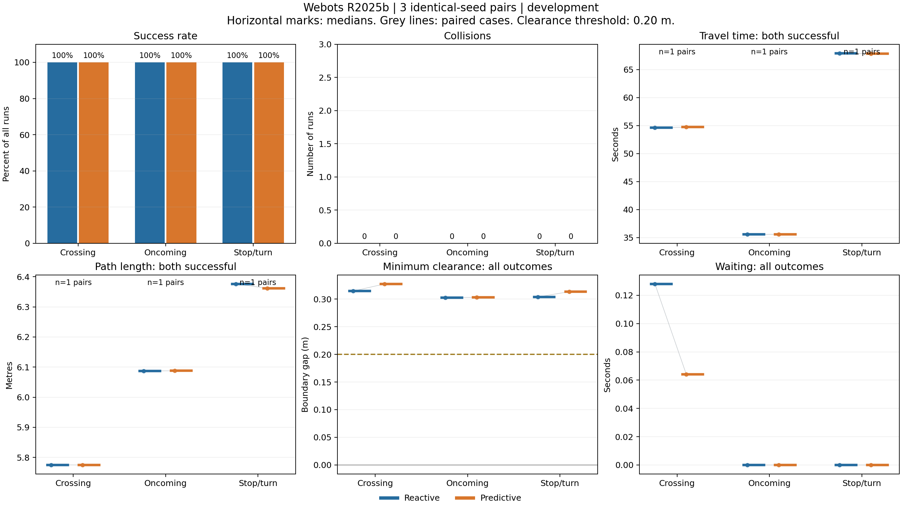
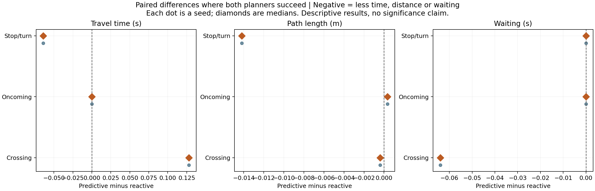

# Paired Webots experiment results

Phase: **development**. 3 pairs / 6 real simulator runs; seeds 3–3; 1 cases per family.

## Outcomes and measurements

| Family | Mode | Success | Collisions | Timeouts | Below 0.20 m | Median time, both succeed (s) | Median path, both succeed (m) | Median min gap, all (m) | Worst gap (m) | Median waiting, all (s) |
| --- | --- | ---: | ---: | ---: | ---: | ---: | ---: | ---: | ---: | ---: |
| crossing | reactive | 1/1 | 0 | 0 | 0/1 | 54.592 | 5.775 | 0.314 | 0.314 | 0.128 |
| crossing | predictive | 1/1 | 0 | 0 | 0/1 | 54.720 | 5.775 | 0.327 | 0.327 | 0.064 |
| oncoming | reactive | 1/1 | 0 | 0 | 0/1 | 35.584 | 6.087 | 0.303 | 0.303 | 0.000 |
| oncoming | predictive | 1/1 | 0 | 0 | 0/1 | 35.584 | 6.088 | 0.303 | 0.303 | 0.000 |
| stop_turn | reactive | 1/1 | 0 | 0 | 0/1 | 67.904 | 6.376 | 0.304 | 0.304 | 0.000 |
| stop_turn | predictive | 1/1 | 0 | 0 | 0/1 | 67.840 | 6.362 | 0.313 | 0.313 | 0.000 |

## Paired differences

Predictive minus reactive. Travel time, path length and this waiting comparison include only cases where **both succeed**.

| Family | Both-success pairs | Median time difference (s) | Median path difference (m) | Median waiting difference (s) | Median min-gap difference, all (m) |
| --- | ---: | ---: | ---: | ---: | ---: |
| crossing | 1 | 0.128 | -0.000 | -0.064 | 0.013 |
| oncoming | 1 | 0.000 | 0.000 | 0.000 | 0.000 |
| stop_turn | 1 | -0.064 | -0.014 | 0.000 | 0.009 |

## Verification and interpretation limits

- Both variants use the same robot, parameters, scripts, control limits, guidance, scoring and braking code. Only the pedestrian motion model differs.
- Every trial uses a fresh Webots process. Scenario/source/environment equality and initial physical states were audited within each pair.
- The raw observations, trajectories and diagnostics were checked for timestamp alignment, scripted pedestrian positions, command limits and consistency with summary metrics.
- Failures and clearance violations are retained. Collision means conservative circle/wall overlap, not exact measured physical contact.
- Travel time and path comparisons are conditional on joint success. Minimum clearance and waiting summaries include all outcomes; early termination limits their interpretation.
- The current integrated scenarios contain **one pedestrian** each. This does not cover the proposal's full one-to-five-person scope.
- Constant-velocity prediction can be wrong after stops/turns. Shared conservative proximity guidance may limit its efficiency benefit.
- The predictor uses four observations and a 0.8 m/s speed cap; it does not receive future script positions.
- These are descriptive simulation results, not evidence of real-world safety or statistical significance.

## Artifacts

- `protocol.json`, `parameters.json`, `cases.json`: prospective settings and exact seeded scripts.
- `frozen_source.zip`: executable source snapshot; `summary.csv`: every measured run.
- `raw_logs.zip`: all per-trial logs, configurations, source snapshots and environments.
- `integrity_audit.json`: per-trial and per-pair checks; `artifact_manifest.json`: file hashes.
- `analysis/metrics_by_family.csv`, `analysis/paired_effects.csv`, `analysis/per_pair_differences.csv`.
- `analysis/paired_analysis.json` and Sophia's three plots are also retained.

