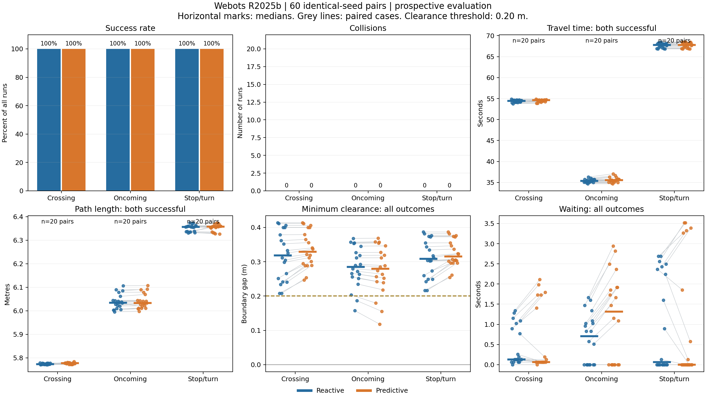
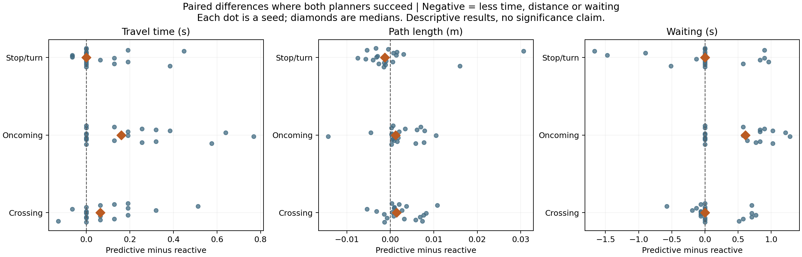
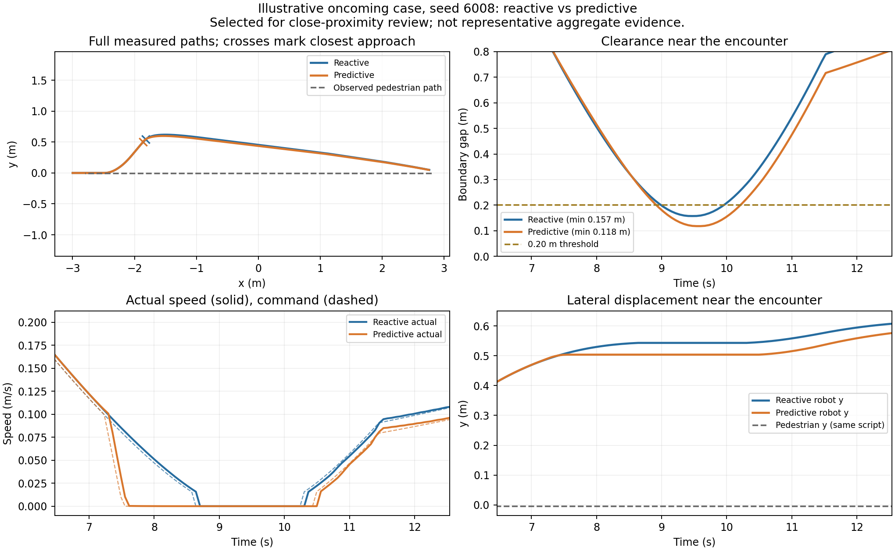

# Paired Webots experiment results

Phase: **prospective_evaluation**. 60 pairs / 120 real simulator runs; seeds 6000–6019; 20 cases per family.

Both modes reached the goal in all 60 cases, with no geometric collisions or
timeouts. Prediction did not improve median paired travel time in these scenes:
the predictive-minus-reactive differences were +0.064 s crossing, +0.160 s
oncoming and 0.000 s stop/turn. Oncoming had 2/20 margin violations in reactive
mode and 3/20 in predictive mode. These are descriptive results under the current
shared conservative controller, not an overall ranking for other environments.

All time and waiting measurements below are **simulation seconds**, not CPU or
wall-clock execution time. All 40 stop/turn runs reached their scripted stop,
turn and final-stop events. The code and parameters remained frozen throughout
collection; `verification.json` records the final source/environment checks.

## Outcomes and measurements

| Family | Mode | Success | Collisions | Timeouts | Below 0.20 m | Median time, both succeed (s) | Median path, both succeed (m) | Median min gap, all (m) | Worst gap (m) | Median waiting, all (s) |
| --- | --- | ---: | ---: | ---: | ---: | ---: | ---: | ---: | ---: | ---: |
| crossing | reactive | 20/20 | 0 | 0 | 0/20 | 54.464 | 5.773 | 0.318 | 0.208 | 0.128 |
| crossing | predictive | 20/20 | 0 | 0 | 0/20 | 54.624 | 5.777 | 0.329 | 0.247 | 0.064 |
| oncoming | reactive | 20/20 | 0 | 0 | 2/20 | 35.360 | 6.034 | 0.284 | 0.157 | 0.704 |
| oncoming | predictive | 20/20 | 0 | 0 | 3/20 | 35.520 | 6.033 | 0.280 | 0.118 | 1.312 |
| stop_turn | reactive | 20/20 | 0 | 0 | 0/20 | 67.808 | 6.357 | 0.308 | 0.216 | 0.064 |
| stop_turn | predictive | 20/20 | 0 | 0 | 0/20 | 67.808 | 6.358 | 0.315 | 0.254 | 0.000 |

## Paired differences

Predictive minus reactive. Travel time, path length and this waiting comparison include only cases where **both succeed**.

The median of per-pair differences generally differs from subtracting the two
separate medians in the preceding table; the paired differences are the primary
within-case comparison.

| Family | Both-success pairs | Median time difference (s) | Median path difference (m) | Median waiting difference (s) | Median min-gap difference, all (m) |
| --- | ---: | ---: | ---: | ---: | ---: |
| crossing | 20 | 0.064 | 0.001 | 0.000 | 0.011 |
| oncoming | 20 | 0.160 | 0.001 | 0.608 | -0.005 |
| stop_turn | 20 | 0.000 | -0.001 | 0.000 | 0.003 |

## Verification and interpretation limits

- Both variants use the same robot, parameters, scripts, control limits, guidance, scoring and braking code. Only the pedestrian motion model differs.
- Every trial uses a fresh Webots process. Scenario/source/environment equality and initial physical states were audited within each pair.
- The raw observations, trajectories and diagnostics were checked for timestamp alignment, scripted pedestrian positions, command limits and consistency with summary metrics.
- Failures and clearance violations are retained. Collision means conservative circle/wall overlap, not exact measured physical contact.
- Travel time and path comparisons are conditional on joint success. Minimum clearance and waiting summaries include all outcomes; early termination limits their interpretation.
- The current integrated scenarios contain **one pedestrian** each. This does not cover the proposal's full one-to-five-person scope.
- Positions are provided by the simulator Supervisor; camera perception and measurement uncertainty are not tested.
- Constant-velocity prediction can be wrong after stops/turns. Shared conservative proximity guidance may limit its efficiency benefit.
- The predictor uses four observations and a 0.8 m/s speed cap; it does not receive future script positions.
- These are descriptive simulation results, not evidence of real-world safety or statistical significance.

## Artifacts

- `protocol.json`, `parameters.json`, `cases.json`: prospective settings and exact seeded scripts.
- `frozen_source.zip`: executable source snapshot; `summary.csv`: every measured run.
- `raw_logs.zip`: all per-trial logs, configurations, source snapshots and environments.
- `integrity_audit.json`: per-trial and per-pair checks; `artifact_manifest.json`: file hashes.
- `analysis/metrics_by_family.csv`, `analysis/paired_effects.csv`, `analysis/per_pair_differences.csv`.
- `analysis/paired_analysis.json` and Sophia's three plots are also retained.





## Illustrative close encounter

Oncoming seed 6008 was selected for inspection because both modes entered the
clearance margin. It is a post-hoc illustration, not representative aggregate
evidence. The traces show the predictive robot stopping with less lateral
displacement before the pedestrian passes. This is consistent with a conservative
forecast interrupting the passing maneuver; further interpretation should use
the archived planner diagnostics rather than treat one case as a general result.



Recreate this supplementary plot with
`python experiments/webots_paired_2026-11-24/make_case_plot.py --family oncoming --seed 6008`.

## Reanalyse from this checkout

Extract `raw_logs.zip` into this directory so it recreates `raw/`. Then run:

```powershell
python pedestrian_navigation/tools/analyze_experiment.py --experiment experiments/webots_paired_2026-11-24
```

The source snapshot and exact dependency versions are included for reproducing
the simulator runs. Choose a new output directory for a new measurement batch;
do not overwrite these frozen results. `main` has not been merged as part of
this verification.
