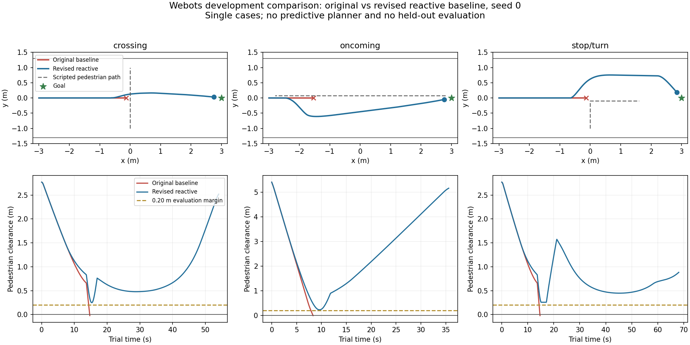

# Research and development log: reactive pedestrian avoidance

Date: November 24, 2026. Scope: Anastasiia's reactive baseline, shared motion
checks, development scenarios, and logging. This file records external findings,
observable evidence, design decisions, and experiment outcomes. It is not a
claim of formal safety or final evaluation.

## Starting evidence

The original source is preserved in
`research/snapshots/baseline_before_pedestrian_improvements.zip`. The unchanged
seed-0 results remain in `results/20261124T073024.104501Z/`.

The empty world succeeds in 29.248 simulated seconds and the static-cylinder
case in 32.320 seconds. The crossing and stop/turn cases terminate at 14.720
seconds with approximately -0.022 m conservative circle clearance. The oncoming
case terminates at 8.320 seconds with approximately -0.009 m clearance. These
are development observations, not estimates of population-level performance.

The trajectories distinguish two mechanisms. In the crossing case, at 14.208 s
the robot is near (-0.207, 0), the pedestrian near (0, -0.660), and the robot still
commands 0.20 m/s. By 14.400 s the boundary gap is already about 0.177 m. Braking
then cannot undo the robot's position in the crossing stream. In the oncoming
case, the robot is practically stationary by 8.000 s, with 0.141 m remaining
clearance; the non-yielding pedestrian subsequently reaches it. This is not
simply the same late-braking failure.

The stop/turn event starts at 15.112 s for seed 0, after the original collision.
Consequently that failed run never exercises the intended motion change. A
later version must log whether the event is actually reached, rather than count
the scenario's name as evidence that it was tested.

## Primary sources and what they support

### 1. Dynamic Window Approach: feasible is not the same as admissible

Fox, Burgard, and Thrun (1997),
[The Dynamic Window Approach to Collision Avoidance](https://publications.ri.cmu.edu/storage/publications/pub_files/pub1/fox_dieter_1997_1/fox_dieter_1997_1.pdf),
DOI: 10.1109/100.580977.

The method searches translational and rotational velocities reachable under the
robot's dynamics and restricts choices to trajectories on which it can stop.
The paper also discusses a rotate-away behavior for local minima and a
speed-dependent side clearance. The relevant distinction for our code is between
respecting acceleration limits and explicitly checking an available braking
trajectory. A finite constant-command rollout alone should not be described as
the full admissibility construction of the original method.

**Project decision:** add a separately inspectable command-and-braking check,
retain wheel and acceleration limits, and keep the term “simplified velocity
sampling baseline.” This does not transfer the paper's guarantees to our code.

### 2. Curvature-Velocity Method: direction and speed belong together

Simmons (1996),
[The Curvature-Velocity Method for Local Obstacle Avoidance](https://publications.ri.cmu.edu/storage/publications/pub_files/pub1/simmons_reid_1996_1/simmons_reid_1996_1.pdf).

This formulation constrains velocity space and optimizes speed, safety, and
goal-directedness together. It treats robot paths as arcs rather than assuming
that a nonholonomic robot can instantly move sideways. It supports keeping
body-velocity sampling and actual differential-drive limits in the experiment.

**Project decision:** a preferred passing point may encourage a turn, but it
must never bypass collision checking or issue a lateral velocity command. The
local controller still chooses feasible forward and turning velocities.

### 3. A stopped robot can still be struck

Mitsch, Ghorbal, Vogelbacher, and Platzer,
[Formal Verification of Obstacle Avoidance and Navigation of Ground Robots](https://arxiv.org/abs/1605.00604),
especially the distinction between passive and passive-friendly safety.

The paper distinguishes avoiding collisions while the robot moves from retaining
enough space for another agent to avoid a stopped robot. The stronger property
depends on assumptions about obstacle motion and braking. It is not a guarantee
for pedestrians that follow arbitrary non-yielding scripts.

**Project interpretation:** the oncoming log is an example of why “brake when
blocked” is incomplete. We must count a pedestrian walking into the stationary
robot as a collision. We cannot exclude it from the results because the robot
had already stopped, or describe our implementation as formally verified.

### 4. An independent proximity monitor is a useful architectural pattern

Nav2 maintainers,
[Collision Monitor documentation](https://github.com/ros-navigation/docs.nav2.org/blob/rolling/docs/configuration_and_development/configuration_guide/core_servers/collision_monitor/configuring_collision_monitor_node.md).

The documented monitor provides a separate layer around planner output, including
stop, slowdown, limit, and approach behaviors. Its approach behavior uses time to
collision. This is an architecture reference, not evidence that our simplified
monitor provides Nav2's functionality or hardware safety certification.

**Project decision:** use a transparent proximity-based slowdown and a shared
braking guard. The baseline must not estimate pedestrian velocities or consult
scripted paths. Therefore we will not call a distance-based rule a pedestrian
time-to-collision predictor. If motion estimation is introduced, that belongs
to Sophia's explicitly predictive variant or a separately disclosed experiment.

### 5. Speed regulation and forward checking can complement path tracking

Nav2 maintainers,
[Regulated Pure Pursuit reference implementation](https://github.com/ros-navigation/navigation2/blob/main/nav2_regulated_pure_pursuit_controller/README.md).

The reference combines path tracking with proximity or curvature regulation and
forward collision checks. This supports treating nominal tracking, regulation,
and command rejection as different responsibilities. It does not imply that we
should replace the project's velocity-sampling comparison with pure pursuit.

## Engineering hypotheses to test

The current objective rewards progress strongly and changes little until an
obstacle is already close to a candidate arc. For a crossing pedestrian, a
current-position model can miss a later conflict even when its static collision
checks are correct. A **position-only proximity slowdown** is a transparent
way to leave more time for replanning. It adds conservatism, not pedestrian
trajectory prediction. Its radius and resulting delay must be reported.

For an oncoming pedestrian, slowing or stopping alone is insufficient. A
**position-only passing preference**, activated before a close encounter, can
encourage the robot to leave the center line. The preferred point must be based
only on current geometry, respect the walls, and remain stable enough to avoid
left-right oscillation. This is a shared engineering heuristic, not an intention
model. It may still fail with multiple pedestrians, sudden changes, or limited
passing space.

At 0.20 m/s and assumed deceleration 0.35 m/s², the simple straight-line stopping
distance is approximately 0.057 m, before control latency and tracking errors.
During a 64 ms update the robot travels another 0.013 m at that speed. These
numbers explain why a braking rule must account for current motion. They do not
bound how far a pedestrian can move or prove an encounter collision-free.

For a fair future comparison, route tracking, passing preferences, slowdown,
sampling, score weights, and the braking guard must be identical in both
variants. Only pedestrian positions used during candidate rollout may differ.
Implementation parameters will be recorded rather than silently tuned per case.

## Planned implementation and checks

1. Factor candidate evaluation and braking checks into a shared module, keeping
   the reactive model stationary during rollout.
2. Add current-position proximity regulation and an early passing preference;
   expose their parameters and diagnostic state in logs.
3. Run a simulator-independent development harness first, then verify selected
   cases in Webots. Kinematic success alone is insufficient.
4. Verify the stop and turn events explicitly. Preserve previous failure logs.
5. Check that empty/static successes and command limits remain intact; inspect
   both collisions and clearance violations in pedestrian cases.

## Experiment outcomes

### Attempt 1: braking guard, proximity slowdown, 2.5 m passing trigger

Kinematic results are preserved in
`results/kinematic_20261124T074538.731528Z/`. Crossing succeeds in 52.928 s but
reaches 0.155 m minimum pedestrian clearance. Stop/turn succeeds in 71.680 s with
0.164 m clearance. Both violate the unchanged 0.20 m evaluation threshold.
Oncoming still collides at 8.832 s. The passing preference starts too late for
the robot to build sufficient lateral displacement under its speed and turning
limits; proximity slowdown also reduces the available lateral motion.

An isolated development probe with the passing trigger moved to 4.0 m succeeds
in the oncoming case: 34.368 s, 0.209 m minimum clearance. This is explicit
development tuning, not a held-out comparison. The trigger still uses only the
pedestrian's present position. No motion direction or velocity is estimated.

### Attempt 2: explicit pedestrian model reserve

The next setting adds a 0.10 m planning reserve around pedestrian circles,
while keeping the logged physical radii, collision definition, and 0.20 m
evaluation margin unchanged. This aims to absorb some reactive delay without
claiming a probabilistic confidence bound. The same reserve must apply to both
future planner variants.

The resulting kinematic batch is in
`results/kinematic_20261124T074722.479517Z/`. All three cases reach the goal, but
crossing still falls to 0.158 m and stop/turn to 0.167 m. Oncoming reaches
0.206 m. The added reserve alone does not solve clearance loss caused by the
pedestrian continuing toward a stopped robot. This negative result matters:
increasing geometric inflation is not equivalent to modeling moving obstacles.

### Attempt 3: earlier proximity slowdown

An isolated development probe increases the slowdown onset from 1.30 to 1.50 m
boundary clearance, keeping the passing trigger at 4.0 m and the model reserve
at 0.10 m. Crossing reaches the goal in 62.080 s with 0.250 m clearance;
stop/turn in 80.768 s with 0.258 m clearance. Both satisfy the unchanged 0.20 m
threshold in the kinematic model. These probe values are not Webots results.

This setting delays the robot before it occupies the crossing stream. The
tradeoff is substantial conservatism, including slower motion near pedestrians
who are already off the center line. That inefficiency must remain visible in
the later comparison; it is not evidence that prediction is unnecessary. The
same slowdown must be applied to the predictive planner unless a different
experimental question is explicitly defined.

Nine unit checks pass, including a short-horizon braking counterexample, stable
passing-side selection, stationary pedestrian rollout, and feasible deceleration
when the proximity cap suddenly decreases. A full Webots development batch is
now running to test the revised implementation against the physics simulator.

### Physics check: why the kinematic result is not sufficient

The first revised Webots batch is in
`results/20261124T074925.966490Z/`, with a source archive and SHA-256 manifest.
Empty and static remain successful at 29.248 s and 32.320 s. Crossing succeeds
in 61.376 s with 0.249 m minimum pedestrian clearance. Oncoming succeeds in
35.520 s, but its clearance is only 0.185 m: still a violation. Thus success
without a geometric collision must not be described as satisfying the margin.

The development response is to increase the preferred passing clearance from
0.35 to 0.45 m, leaving the evaluation threshold and collision radii unchanged.
An isolated kinematic oncoming probe then succeeds in 35.648 s with 0.230 m
minimum clearance. This remains a heuristic adjustment requiring another physics
check. We do not change the pedestrian script or exclude the failed margin result.

### Revised seed-0 Webots result

The final batch for this development step is
`results/20261124T075112.859332Z/`. It contains the resolved parameter values,
source archive, source hashes, exact observations, trajectories, and summaries.

| Scenario | Outcome | Time | Minimum pedestrian clearance | Waiting | Margin violation |
| --- | --- | ---: | ---: | ---: | --- |
| Crossing | Success | 54.080 s | 0.249 m | 0.896 s | No |
| Oncoming | Success | 35.584 s | 0.228 m | 1.280 s | No |
| Stop/turn | Success | 68.096 s | 0.257 m | 2.368 s | No |

All three scheduled stop/turn events are reached before termination. The event
times and script itself remain unchanged from the original case. Empty/static
regression runs passed in the first revised physics batch at 29.248/32.320 s;
the final passing-clearance adjustment is unused in scenes without pedestrians.
Nine unit checks pass after the final controller settings.

The figure compares two revisions of the reactive baseline, not reactive versus
predictive navigation. Each red trace ends at the original collision; it must
not be used to claim a successful paired travel-time improvement. Full scripted
paths are displayed only for retrospective analysis, never supplied to planning.

## Current implementation and limits

Candidate generation, scoring, proximity regulation, passing preference, and
the braking guard now live in shared modules. The reactive subclass returns
the same observed pedestrian positions for every rollout time. Diagnostic logs
make the chosen guide point, feasible-command count, braking, and speed cap
inspectable. Future predictive integration should override only the pedestrian
motion model and update its observation history once per control cycle.

The passing preference is deliberately limited to this x-oriented walkway and
uses stable within-trial pedestrian ordering. It does not solve general
multi-agent negotiation. It is not an implementation of the source papers'
formal controllers. The empirical 0.10 m reserve is not a proven uncertainty
bound. Current-position braking checks cannot guarantee safety against a
pedestrian who deliberately or accidentally walks into a stopped robot.

Seeds 0, 1, and 2 are development material once inspected; none may later be
relabeled held-out. No final 60-pair evaluation has been run and no parameters
are frozen for that evaluation. Remaining work includes several pedestrians,
less favorable timing and geometry, predictor integration, and protocol review.

## Additional development variation

The current controller was also run on seeds 1 and 2 in the kinematic harness,
with results stored in `results/kinematic_20261124T075345.052301Z/`.

| Seed | Scenario | Outcome | Time | Minimum pedestrian clearance |
| --- | --- | --- | ---: | ---: |
| 1 | Crossing | Success | 54.464 s | 0.251 m |
| 1 | Oncoming | Success | 35.072 s | 0.369 m |
| 1 | Stop/turn | Success | 68.224 s | 0.260 m |
| 2 | Crossing | Success | 53.824 s | 0.202 m |
| 2 | Oncoming | Success | 35.264 s | 0.255 m |
| 2 | Stop/turn | Success | 68.224 s | 0.210 m |

Although all six reach the goal without a recorded margin violation in that
model, seed 2 crossing has only about 1.5 mm above the threshold. Given the
previous observed discrepancy between kinematics and physics, this is not a
robust clearance result. The seed-0 success must not be generalized to all
parameter choices.

The focused Webots check is complete and stored in
`results/20261124T075427.634085Z/`:

| Seed | Scenario | Outcome | Time | Minimum pedestrian clearance |
| --- | --- | --- | ---: | ---: |
| 2 | Crossing | Success | 53.760 s | 0.200728 m |
| 2 | Stop/turn | Success | 68.352 s | 0.209365 m |

No collision or margin violation is recorded, and all stop/turn events are
reached. However, crossing is only about **0.73 mm above the threshold**. This is
a borderline development result, not a robust safety margin. It justifies
keeping protocol review, more diverse cases, and sensitivity testing open.
No settings were changed after this focused check.

## Decisions for the next project step

The current baseline is usable for continued development: all inspected Webots
cases reach the goal, their failures and near failures are documented, and the
controller can be reproduced from its source snapshots. This is a narrower
claim than successful pedestrian navigation in general.

Before freezing the experiment, add two to five pedestrians and more offsets,
including cases where the preferred passing side is blocked. Review whether
the broad radial slowdown zone suppresses the efficiency differences that the
prediction experiment is meant to measure. A controlled development ablation
can separate the effects of guidance, slowdown, and the pedestrian motion model;
it must not be substituted for the planned fair held-out comparison. Integrate
Sophia's predictor through the shared interface only after this review.

All five linked references above are primary papers or official project
documentation, accessed on November 24, 2026. Published results are kept
separate from our own unverified assumptions, engineering heuristics, and
measured development outcomes.
